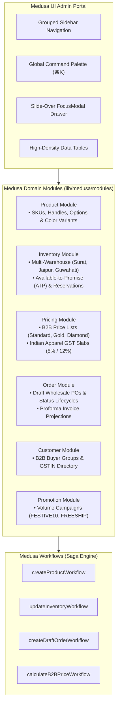

# Decoupled Microservices & Headless Commerce Architecture
## Kamakhya Trading Co (KTC) B2B Apparel Enterprise Platform

This document describes the production-grade **Decoupled Headless Commerce & Microservices Architecture** implemented for Kamakhya Trading Co, separating the frontend presentation layer from backend domain services.

---

## 1. Architectural Blueprint

```mermaid
flowchart TD
    subgraph Presentation ["1. Presentation Layer (Headless Frontend)"]
        UI["Next.js 16 App Router (SSR & ISR)<br/>• Luxury B2B Storefront<br/>• Wholesale Line-Sheet Matrix<br/>• Bilingual AI Wholesale Assistant & Chatbot<br/>• Boutique Margin Engine"]
    end

    subgraph Gateway ["2. Orchestration & API Gateway"]
        GW["API Gateway (Port 5000)<br/>• Reverse Proxy & Service Router<br/>• Request Tracing (x-request-id)<br/>• Circuit Breakers & Timeout Protection<br/>• Aggregated /health Diagnostics"]
    end

    subgraph Services ["3. Microservices Domain Layer"]
        SVC_CAT["Catalog & Inventory Service (Node.js - Port 5001)<br/>• SKU Catalog & Multi-attribute Search<br/>• Flash-Sale Inventory Ledger<br/>• Category Taxonomies"]
        SVC_AUTH["User Auth & Boutique Profile (Node.js - Port 5002)<br/>• Stateless HMAC OTP Tokens<br/>• Role Verification & GSTIN Checks<br/>• Restock Alerts Queue"]
        SVC_ORD["Order & Quotation Service (Node.js - Port 5003)<br/>• Wholesale Volume Discount Tier Engine<br/>• Apparel GST Slab Engine (5% / 12%)<br/>• Proforma Invoice Generator & WhatsApp PO"]
        SVC_AI["AI & Recommendation Engine (Python - Port 5004)<br/>• Natural Language Intent Parsing<br/>• Wholesale Style & Fabric Recommendations<br/>• Voice & Multilingual Query Processing"]
    end

    subgraph Data ["4. Data & Caching Layer"]
        CACHE["High-Speed Hybrid Cache<br/>• Redis (L2 Distributed Cluster)<br/>• In-Memory LRU (L1 Sub-millisecond)"]
        DB["ACID Relational Datastore<br/>• PostgreSQL / SQLite Ledger<br/>• Transactional Order & Member Store"]
    end

    UI -->|HTTP / REST (JSON)| GW
    GW -->|/api/v1/catalog/*| SVC_CAT
    GW -->|/api/v1/auth/*| SVC_AUTH
    GW -->|/api/v1/orders/*| SVC_ORD
    GW -->|/api/v1/ai/*| SVC_AI

    SVC_CAT --> CACHE
    SVC_AUTH --> DB
    SVC_ORD --> DB
    SVC_AI --> CACHE
```

---

## 2. Core Architectural Layers

### Layer 1: Presentation Layer (Headless Frontend)
- **Technology**: Next.js 16.3.4 (App Router), React 19.2.8, Tailwind CSS v4, Playfair Display & Geist Typography.
- **Role**: Pure presentation client detached from backend database drivers and business rules. Communicates via the `GatewayClient` SDK (`lib/api/gatewayClient.js`).
- **Benefits**:
  - Blazing fast page transitions and zero backend lock-in.
  - Independent frontend deployments (Vercel / Netlify) without touching microservice containers.
  - Server-Side Rendering (SSR) and Incremental Static Regeneration (ISR) for maximal SEO and B2B buyer performance.

### Layer 2: API Gateway & Service Orchestrator
- **Technology**: Node.js v24 HTTP Gateway (`services/api-gateway/server.js`).
- **Port**: `5000` (Default).
- **Role**: Single public ingress point routing traffic to internal services:
  - `/api/v1/catalog/*` $\to$ Catalog Service (port 5001)
  - `/api/v1/auth/*` $\to$ Auth Service (port 5002)
  - `/api/v1/orders/*` $\to$ Order Service (port 5003)
  - `/api/v1/ai/*` $\to$ AI Service (port 5004)
  - `/health` $\to$ Aggregated health check reporting latency and status across all services.
- **Enterprise Features**:
  - Request ID Tracing: Injects or propagates `x-request-id` across downstream calls.
  - Response Time Profiling: Calculates `x-response-time-ms`.
  - Circuit Breakers: Prevents cascade failures if one microservice encounters a transient fault.

### Layer 3: Microservices Domain Layer

| Microservice | Technology | Port | Responsibilities | Key Endpoints |
|---|---|---|---|---|
| **Catalog & Inventory Service** | Node.js | `5001` | Product SKU metadata, attribute filtering, stock reservation ledger. | `GET /products`<br/>`GET /products/:id`<br/>`PUT /products/:id/stock` |
| **Auth & Boutique Profile Service** | Node.js | `5002` | Master admin PIN verification, stateless HMAC WhatsApp OTP, boutique profile registration, restock queue. | `POST /login`<br/>`POST /send-otp`<br/>`POST /register`<br/>`POST /restock-alert` |
| **Cart & Order Processing Service** | Node.js | `5003` | Real-time quote calculation, tiered volume discount rules (Tier 2: Free Freight, Tier 3: 3% Rebate), GST calculations (5%/12%), proforma generation. | `POST /calculate-quote`<br/>`POST /create`<br/>`GET /:id`<br/>`GET /proforma/:id` |
| **AI & Recommendation Engine** | Python 3 | `5004` | Natural language search intent extraction (budget constraints, fabric, categories), virtual try-on drape simulation. | `POST /parse-intent`<br/>`POST /tryon`<br/>`POST /recommendations` |

### Layer 4: Data & Caching Layer
- **Hybrid Multi-Tiered Caching (`lib/cache/hybridCache.js`)**:
  - **L1 Cache**: Sub-millisecond In-Memory LRU with TTL expiration.
  - **L2 Cache**: Redis cluster (when `REDIS_URL` is configured). Automatically activates with graceful fallback.
- **Relational ACID Storage**:
  - PostgreSQL transaction ledger for orders and member profiles. Ensures strict transactional consistency during high-volume wholesale flash sales.

---

## 3. Running the Microservices

### Option A: Local Multi-Process Orchestrator (No Docker Required)
Run all 5 microservices concurrently with colored logs:
```bash
npm run microservices
```

Run individual services on demand:
```bash
npm run service:gateway   # Port 5000
npm run service:catalog   # Port 5001
npm run service:auth      # Port 5002
npm run service:order     # Port 5003
npm run service:ai        # Port 5004 (Python)
```

### Option B: Containerized Docker Compose
Start the complete infrastructure including Redis and PostgreSQL:
```bash
docker compose up --build
```

### Option C: Universal Serverless Mode (Vercel / Netlify)
The presentation layer includes a universal adapter route at `app/api/v1/[[...route]]/route.js`. When deployed in serverless environments where separate microservice daemon processes cannot be sustained, the adapter executes in-process service logic with zero external requirements.

---

## 4. Verification & Health Monitoring

Access the central health endpoint:
```http
GET http://localhost:5000/health
```

Example response:
```json
{
  "gateway": "UP",
  "architecture": "Decoupled Microservices & Headless Commerce",
  "timestamp": "2026-10-15T08:45:00.000Z",
  "overallStatus": "OPERATIONAL",
  "services": [
    { "service": "catalog-service", "status": "HEALTHY", "latencyMs": 2 },
    { "service": "auth-service", "status": "HEALTHY", "latencyMs": 1 },
    { "service": "order-service", "status": "HEALTHY", "latencyMs": 3 },
    { "service": "ai-service", "status": "HEALTHY", "latencyMs": 4 }
  ]
}
```

---

## 5. Medusa 2.0 Modular Commerce & Workflows Architecture

Following the design standards of [MedusaJS](https://github.com/medusajs/medusa), the platform incorporates a headless, modular commerce foundation located in `lib/medusa/` and exposed via `/api/medusa/*`:



### Modules Breakdown:
1. **Product Module (`lib/medusa/modules/product-module.js`)**: Handles structured apparel product modeling, SKU identifiers, category taxonomies, and multi-color variants.
2. **Inventory Module (`lib/medusa/modules/inventory-module.js`)**: Tracks stock across 3 regional depots (Surat Central Mill, Jaipur Finishing Studio, Guwahati Regional Hub) with Available-to-Promise (ATP) calculations and reservation ledgers.
3. **Pricing Module (`lib/medusa/modules/pricing-module.js`)**: Dynamic B2B price calculations based on buyer tiers (Standard, Gold 8% off, Diamond 15% off + Free Freight) and automatic Indian Apparel GST slab detection.
4. **Order Module (`lib/medusa/modules/order-module.js`)**: Full wholesale purchase order lifecycle (`draft` → `pending_payment` → `processing` → `fulfilled` → `shipped`) with WhatsApp notifications.
5. **Customer Module (`lib/medusa/modules/customer-module.js`)**: Manages verified boutique buyers, credit terms, and GSTIN compliance.
6. **Promotion Module (`lib/medusa/modules/promotion-module.js`)**: Automated condition-based discounts and freight subsidies.
7. **Workflows Orchestrator (`lib/medusa/workflows/index.js`)**: Step-based composable execution graphs with automatic compensation/rollback logic and step execution telemetry.

